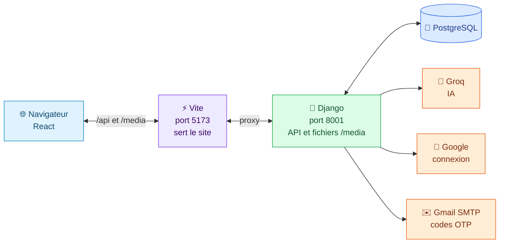
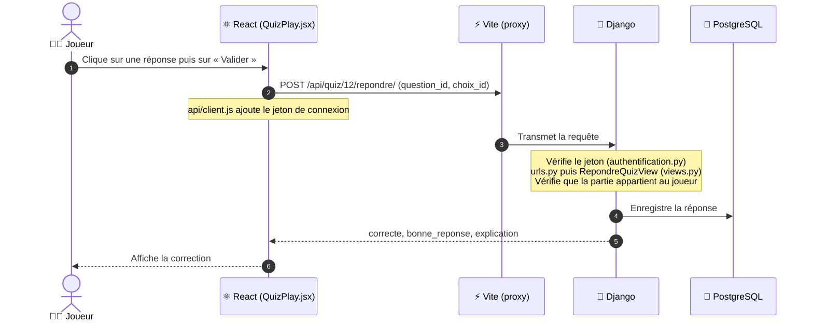
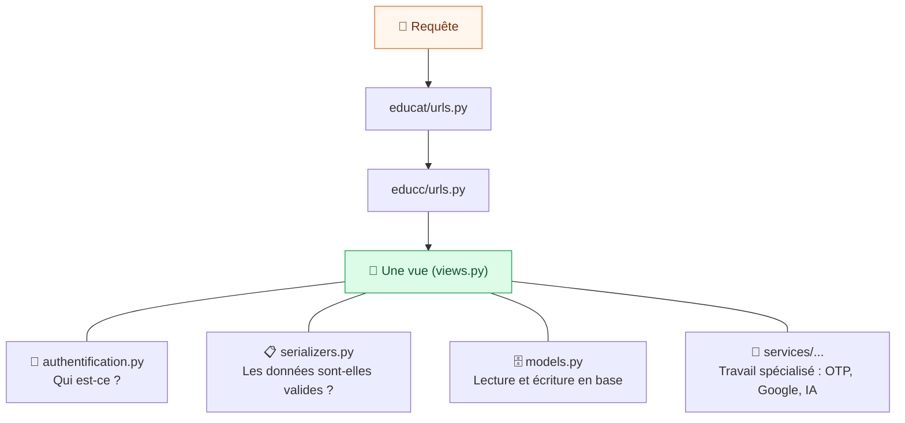
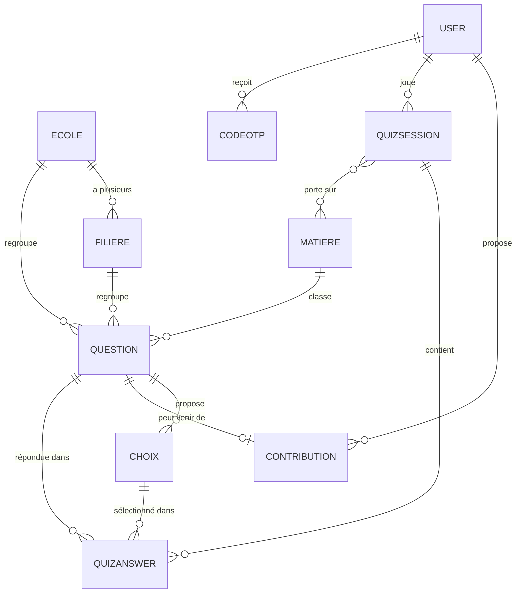
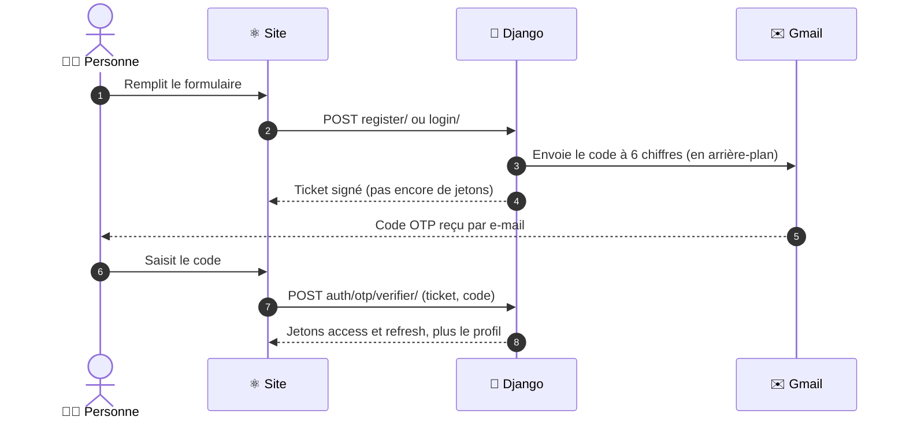
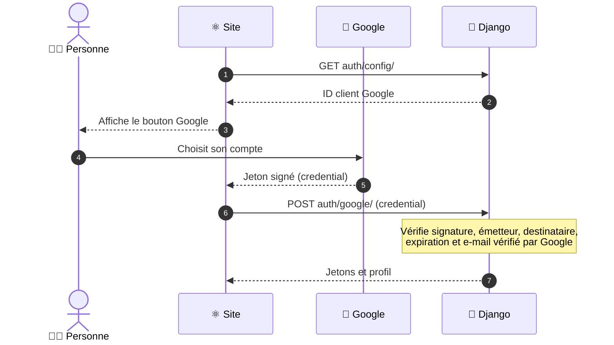
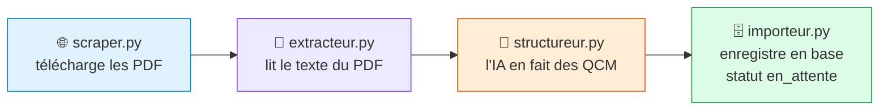
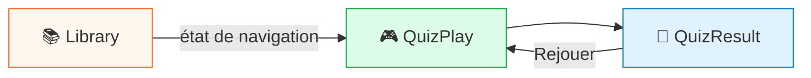

<div align="center">


# DMAEDUCATION

### 🎓 Révise les vraies annales. Progresse à chaque quiz.

Plateforme web de révision par quiz pour préparer les **concours d'entrée des grandes écoles ivoiriennes** (aujourd'hui l'**ESATIC**).<br/>
Les candidats s'entraînent sur de vraies questions d'annales, en mode libre ou chronométré,<br/>
et un administrateur suit l'activité du site depuis un tableau de bord.

<br/>


<br/>

**[✨ Fonctionnalités](#s1)** · **[🏗️ Architecture](#s2)** · **[🚀 Installation](#s4)** · **[🔌 API](#s10)** · **[🎨 Frontend](#s19)** · **[🛠️ Dépannage](#s26)**

</div>

<br/>

## 📦 Le projet en un coup d'œil

Deux programmes tournent ensemble :

| | Dossier | Rôle | Technologies |
|:-:|---|---|---|
| 🐍 | `educat/` | **Backend** : le serveur, qui garde les données et applique les règles | Python, Django 5.2, Django REST Framework, PostgreSQL |
| ⚛️ | `educat-front/` | **Frontend** : le site que l'on voit dans le navigateur | React 19, Vite, Tailwind CSS |
| 📦 | `educ/` | Environnement virtuel Python (bibliothèques installées, **ne pas modifier**) | |

<div align="center">

| 5 | 3 | 15 | 42 | 1 |
|:-:|:-:|:-:|:-:|:-:|
| matières | usages de l'IA | migrations | tests automatiques | école (ESATIC) |

</div>

<a id="sommaire"></a>

## 🧭 Sommaire

| Partie | Sections |
|---|---|
| **🌟 Partie 1 — Vue d'ensemble** | [1. Fonctionnalités](#s1) · [2. Architecture générale](#s2) · [3. Technologies utilisées](#s3) |
| **🚀 Partie 2 — Mise en route** | [4. Installation](#s4) · [5. Configuration (.env)](#s5) · [6. Lancer le projet](#s6) |
| **🐍 Partie 3 — Le backend en détail** | [7. Fichiers](#s7) · [8. Réglages](#s8) · [9. Modèle de données](#s9) · [10. Routes de l'API](#s10) · [11. Connexion et sécurité](#s11) · [12. Déroulement d'un quiz](#s12) · [13. Présence et tableau de bord](#s13) · [14. Intelligence artificielle](#s14) · [15. Importer des questions](#s15) · [16. Administration Django](#s16) · [17. Tests](#s17) |
| **⚛️ Partie 4 — Le frontend en détail** | [18. Fichiers](#s18) · [19. Démarrage et styles](#s19) · [20. Pages et navigation](#s20) · [21. Communication avec l'API](#s21) · [22. Gestion de la session](#s22) · [23. Les pages](#s23) · [24. Les composants](#s24) |
| **🔭 Partie 5 — Aller plus loin** | [25. Mise en ligne](#s25) · [26. Dépannage](#s26) · [27. Limites connues](#s27) |

<br/>

---

<a id="p1"></a>

# 🌟 Partie 1 : vue d'ensemble

<a id="s1"></a>

## 🎯 1. Fonctionnalités

### 🎓 Pour les candidats

| | Fonctionnalité | Ce que ça fait |
|:-:|---|---|
| 📚 | **Bibliothèque de matières** | Mathématiques, Physique, Informatique, Anglais, Français, présentées sous forme de carrousel de livres. |
| 🎛️ | **Quiz configurables** | Choix de la matière, du mode (libre ou chronométré, 30 secondes par question) et du nombre de questions. |
| 🧩 | **Sous-branches en Informatique** | *Développement d'application web*, *Réseau informatique*, *Systèmes d'exploitation et architecture*, ou *Mixte* (toutes les questions). Un quiz d'une branche ne contient aucune question des autres. |
| ✅ | **Correction immédiate** | Après chaque réponse : juste ou faux, bonne réponse en cas d'erreur, et explication. |
| ➗ | **Formules mathématiques** | Écrites en LaTeX dans la base, rendues proprement à l'écran. |
| 📊 | **Page de résultat** | Score en pourcentage sous forme de graphique, détail question par question, bouton « Rejouer » avec les mêmes réglages. |
| 👤 | **Profil** | Quiz terminés, score moyen, meilleur score, modification du nom d'utilisateur et de l'e-mail. |

### 🔐 Pour se connecter

| | Méthode | Détail |
|:-:|---|---|
| 🔢 | **Nom d'utilisateur + mot de passe** | Confirmés par un **code OTP à 6 chiffres envoyé par e-mail**, à l'inscription comme à chaque connexion. |
| 🔑 | **Google** | Connexion en un clic, sans mot de passe ni code. |

### 👑 Pour l'administrateur

| | Fonctionnalité | Détail |
|:-:|---|---|
| 📈 | **Tableau de bord** | Inscrits, comptes en ligne en temps réel, activité des 30 derniers jours, répartition des questions, taux de réussite par matière, meilleurs utilisateurs. |
| 🚪 | **Gestion des comptes** | Déconnecter un compte à distance, ou le supprimer. |
| 🛡️ | **Modération des questions** | Dans l'administration Django : valider, rejeter, classer par branche. |

### ⚙️ En coulisses

| | Fonctionnalité | Détail |
|:-:|---|---|
| 📥 | **Import automatique d'annales** | Téléchargement de PDF, extraction du texte, transformation en QCM par une IA. |
| 🤖 | **Correction d'exercices par IA** | Prête côté serveur (voir les [limites connues](#s27) pour le site). |

<a id="s2"></a>

## 🏗️ 2. Architecture générale



> [!NOTE]
> **Le principe.** Le frontend ne contient aucune donnée : c'est une application React qui s'exécute dans le navigateur et demande tout au backend par des requêtes HTTP (`GET /api/matieres/`, `POST /api/quiz/demarrer/`...). Le backend répond en JSON. **C'est le backend qui décide de ce qui est autorisé** : le frontend peut cacher un bouton, mais la vraie vérification est toujours faite par Django.

> [!TIP]
> **Le proxy de développement.** Le site appelle l'API à la même adresse que lui (`/api/...`). Vite transmet ces appels à Django grâce au proxy défini dans `educat-front/vite.config.js`. Conséquences : aucune configuration CORS n'est nécessaire, et le site fonctionne de la même façon sur l'ordinateur, à travers ngrok, ou sur un téléphone du même Wi-Fi.

### 🔄 Parcours d'une action : « répondre à une question »



<a id="s3"></a>

## 🧰 3. Technologies utilisées

### 🐍 Backend

| Bibliothèque | Rôle dans le projet |
|---|---|
| **Django 5.2** | Structure du serveur, accès à la base de données, administration |
| **Django REST Framework** | Construction de l'API JSON (vues, serializers, permissions) |
| **SimpleJWT** | Jetons de connexion (JWT) |
| **PostgreSQL + psycopg** (avec pool) | Base de données, avec des connexions gardées ouvertes et réutilisées |
| **django-filter** | Filtrage de la banque de questions par l'adresse (`?matiere=2`) |
| **django-cors-headers** | Autorisation des appels venant d'un autre domaine |
| **python-decouple** | Lecture du fichier `.env` |
| **argon2-cffi** | Hachage des mots de passe |
| **PyJWT** | Vérification des jetons remis par Google |
| **groq** | Appels à l'IA |
| **json-repair** | Réparation des réponses JSON mal formées de l'IA |
| **pdfplumber** | Lecture du texte des PDF d'annales |
| **requests, beautifulsoup4** | Téléchargement et analyse des pages qui listent les annales |

### ⚛️ Frontend

| Bibliothèque | Rôle dans le projet |
|---|---|
| **React 19** | Construction de l'interface en composants |
| **Vite 8** | Serveur de développement, proxy vers Django, construction du site |
| **React Router 7** | Navigation entre les pages sans recharger le site |
| **Axios** | Appels à l'API |
| **Tailwind CSS** | Mise en forme par classes utilitaires |
| **KaTeX** (react-katex) | Affichage des formules mathématiques |
| **Chart.js** (react-chartjs-2) | Graphiques de l'accueil et du tableau de bord |
| **Recharts** | Graphique du score et courbes du tableau de bord |
| **Google Identity Services** | Bouton « Se connecter avec Google » (script chargé depuis Google) |
| **Material Symbols** | Icônes |

<div align="right"><a href="#sommaire">⬆️ Retour au sommaire</a></div>

---

<a id="p2"></a>

# 🚀 Partie 2 : mise en route

<a id="s4"></a>

## 📥 4. Installation

### ✅ Prérequis

| | Outil | Version |
|:-:|---|---|
| 🐍 | Python | 3.12 ou plus récent |
| 🟢 | Node.js | 20 ou plus récent |
| 🐘 | PostgreSQL | 14 ou plus récent |
| 🤖 | Clé API Groq | gratuite sur [console.groq.com](https://console.groq.com) |

### 🐘 Étape 1 : la base de données

Crée une base PostgreSQL vide et un utilisateur qui y a accès :

```sql
CREATE DATABASE educat;
CREATE USER educat_user WITH PASSWORD 'un-mot-de-passe';
ALTER DATABASE educat OWNER TO educat_user;
ALTER USER educat_user CREATEDB;   -- nécessaire seulement pour lancer les tests
```

### 🐍 Étape 2 : le backend

Depuis la racine du projet, sous Windows :

```powershell
python -m venv educ
educ\Scripts\activate
cd educat
pip install -r requirements.txt
copy .env.example .env      # puis remplis le fichier .env (section suivante)
python manage.py migrate
python manage.py createsuperuser
```

- `migrate` crée toutes les tables et les matières de départ.
- `createsuperuser` crée le compte administrateur. Donne-lui une **vraie adresse e-mail** : c'est là qu'arrivera son code OTP.

> [!IMPORTANT]
> Crée ensuite au moins **une école** (par exemple ESATIC) et ses filières dans l'administration Django : elles sont nécessaires pour importer des questions.

### ⚛️ Étape 3 : le frontend

```powershell
cd educat-front
npm install
```

<a id="s5"></a>

## 🔧 5. Configuration (fichier .env)

Le fichier `educat/.env` contient les réglages et les secrets du serveur. Un modèle vide est fourni dans `educat/.env.example`.

> [!WARNING]
> Le `.env` n'est lu **qu'au démarrage** : relance Django après chaque modification.

| Variable | Obligatoire | Rôle |
|---|:-:|---|
| `SECRET_KEY` | ✅ | Clé secrète de Django, qui signe aussi les jetons de connexion et les tickets OTP. Au moins 50 caractères aléatoires. |
| `DEBUG` | | `True` en développement, `False` en ligne. |
| `ALLOWED_HOSTS` | | Domaines autorisés, séparés par des virgules. |
| `DB_NAME`, `DB_USER`, `DB_PASSWORD` | ✅ | Accès à la base PostgreSQL. |
| `DB_HOST`, `DB_PORT` | | `127.0.0.1` et `5432` par défaut. Préfère `127.0.0.1` à `localhost`, plus rapide sous Windows. |
| `GROQ_API_KEY` | ✅ | Clé de l'IA. **Le serveur ne démarre pas sans elle.** |
| `GOOGLE_CLIENT_ID` | | ID client OAuth Google. Sans lui, le bouton Google n'apparaît pas. |
| `EMAIL_HOST_USER`, `EMAIL_HOST_PASSWORD` | | Adresse Gmail et mot de passe d'application pour envoyer les codes OTP. Sans eux, le code s'affiche dans le terminal de Django. |

<details>
<summary><b>🔑 Activer la connexion Google</b></summary>

<br/>

1. Sur [console.cloud.google.com](https://console.cloud.google.com), ouvre **API et services > Identifiants**.
2. Crée un **ID client OAuth** de type **Application Web**.
3. Dans **Origines JavaScript autorisées**, ajoute chaque adresse où le site est ouvert : `http://localhost:5173`, `http://localhost`, et l'adresse `https://` du site en ligne ou de ngrok. Écris le protocole, le domaine et le port, sans `/` final.
4. Copie l'**ID client** (il se termine par `.apps.googleusercontent.com`) dans `GOOGLE_CLIENT_ID`. Ne copie pas le « code secret du client » : le projet n'en a pas besoin.

</details>

<details>
<summary><b>✉️ Activer l'envoi des codes par Gmail</b></summary>

<br/>

1. Active la validation en deux étapes sur le compte Google expéditeur.
2. Crée un mot de passe d'application sur [myaccount.google.com/apppasswords](https://myaccount.google.com/apppasswords).
3. Renseigne `EMAIL_HOST_USER` (l'adresse Gmail) et `EMAIL_HOST_PASSWORD` (les 16 lettres).

</details>

<a id="s6"></a>

## ▶️ 6. Lancer le projet

Il faut **deux terminaux** ouverts en même temps.

**🐍 Terminal 1, le backend :**

```powershell
educ\Scripts\activate
cd educat
python manage.py runserver 8001
```

**⚛️ Terminal 2, le frontend :**

```powershell
cd educat-front
npm run dev
```

Le site est alors disponible sur **[http://localhost:5173](http://localhost:5173)** 🎉

> [!NOTE]
> Le port **8001** est celui attendu par le proxy de Vite. Pour en changer, modifie la constante `DJANGO` dans `educat-front/vite.config.js`, puis relance `npm run dev`.

**📱 Accès depuis un téléphone ou de l'extérieur :** lance `ngrok http 5173`, puis ajoute l'adresse obtenue dans `allowedHosts` (`vite.config.js`) et dans les origines autorisées de Google.

| Adresse | Ce qu'on y trouve |
|---|---|
| `http://localhost:5173` | 🌐 Le site |
| `http://localhost:5173/dashboard` | 📈 Le tableau de bord (compte administrateur) |
| `http://localhost:8001/admin/` | 🛡️ L'administration Django |
| `http://localhost:8001/api/matieres/` | 🔌 Un exemple de réponse de l'API |

<div align="right"><a href="#sommaire">⬆️ Retour au sommaire</a></div>

---

<a id="p3"></a>

# 🐍 Partie 3 : le backend en détail

<a id="s7"></a>

## 🗂️ 7. Organisation des fichiers du backend

```
educat/
├── manage.py                 point d'entrée des commandes Django
├── requirements.txt          bibliothèques Python à installer
├── .env                      réglages et secrets (jamais partagé)
├── .env.example              modèle vide du fichier .env
├── educat/                   configuration du projet
│   ├── settings.py           tous les réglages du serveur
│   ├── urls.py               /admin/ et /api/ (+ /media/ en développement)
│   └── wsgi.py, asgi.py      points d'entrée pour un hébergement
├── educc/                    l'application (toute la logique)
│   ├── models.py             tables de la base de données
│   ├── serializers.py        conversion modèles <-> JSON, validation des entrées
│   ├── views.py              comptes, connexion, banque de questions, quiz
│   ├── views_admin.py        tableau de bord, présence en ligne, actions sur les comptes
│   ├── urls.py               liste des routes de l'API
│   ├── authentification.py   jetons JWT révocables
│   ├── hashers.py            réglages du hachage Argon2
│   ├── correction_ia.py      correction des exercices par l'IA
│   ├── admin.py              configuration de l'administration Django
│   ├── tests.py              tests automatiques
│   ├── migrations/           historique des changements de la base (15 fichiers)
│   ├── services/
│   │   ├── otp.py            codes OTP par e-mail
│   │   ├── google_auth.py    vérification des connexions Google
│   │   ├── scraper.py        téléchargement des PDF d'annales
│   │   ├── extracteur.py     lecture du texte des PDF
│   │   ├── structureur.py    transformation du texte en QCM par l'IA
│   │   ├── importeur.py      enregistrement des questions en base
│   │   └── vision_ia.py      lecture d'exercices en image par l'IA
│   └── management/commands/  commandes d'import et de classement
├── media/                    images des questions
└── annales_master/, test_maths/   PDF d'annales déjà traités
```

**🧭 Comment une requête traverse ces fichiers :**



<a id="s8"></a>

## ⚙️ 8. Réglages du serveur

Tout se trouve dans `educat/educat/settings.py`.

| Réglage | Valeur | Explication |
|---|---|---|
| 👤 Modèle utilisateur | `educc.User` | Le projet a son propre modèle de compte, qui étend celui de Django. |
| 🐘 Base de données | PostgreSQL avec un **pool** de 2 à 10 connexions | Les connexions restent ouvertes et sont partagées entre les requêtes. Sans cela, chaque appel perdait 0,3 à 0,6 seconde à se reconnecter. |
| 🔐 Authentification par défaut | `educc.authentification.AuthentificationJWT` | Jetons JWT, avec refus des sessions fermées par un administrateur. |
| 🚦 Permission par défaut | `IsAuthenticatedOrReadOnly` | Sans précision, tout le monde peut lire, mais il faut être connecté pour modifier. |
| ⏱️ Durée des jetons | accès 6 heures, renouvellement 7 jours | |
| 🔒 Hachage des mots de passe | Argon2id, puis PBKDF2 en secours | Voir la [section 11](#s11). |
| ✉️ E-mail | Gmail en SMTP si configuré, sinon affichage dans le terminal | |
| 🌍 CORS | toutes origines si `DEBUG` est vrai | À restreindre en production. |
| 🇫🇷 Langue et fuseau | français, `Africa/Abidjan` | |
| 🖼️ Fichiers envoyés | dossier `media/`, servis sous `/media/` | |

<a id="s9"></a>

## 🗄️ 9. Modèle de données

### 🕸️ Schéma des relations



### 📘 Les modèles

**🏫 `Ecole`** : une école. Champs : `nom` (unique), `description`, `slug`.

**🎓 `Filiere`** : une filière d'une école. Champs : `ecole`, `nom`, `niveau` (`licence`, `master` ou `ingenieur`).

**👤 `User`** : un compte. Il reprend les champs de Django (`username`, `email`, `password`, `is_superuser`, `is_active`, `date_joined`...) et ajoute :

| Champ | Rôle |
|---|---|
| `role` | `candidat` (par défaut), `moderateur` ou `admin` |
| `ecole_ciblee`, `filiere_ciblee` | École et filière visées par le candidat |
| `derniere_activite`, `a_quitte` | Dernier signal de présence reçu, et départ volontaire |
| `google_sub` | Identifiant du compte Google rattaché (unique) |
| `email_verifie` | Vrai quand l'adresse a été prouvée par un code OTP ou par Google |
| `sessions_invalides_avant` | Date en dessous de laquelle les sessions sont refusées (déconnexion par l'admin) |

**🔢 `CodeOTP`** : un code de vérification en attente. Champs : `user`, `objet` (`inscription` ou `connexion`), `code_hache` (empreinte du code, jamais le code), `envoye_le`, `expire_le`, `tentatives`, `utilise`.

**📚 `Matiere`** : une matière. Champs : `nom` (unique), `icone`.

**❓ `Question`** : une question de la banque.

| Champ | Rôle |
|---|---|
| `type_question` | `qcm` ou `exercice` (réponse rédigée) |
| `enonce` | Texte de la question, formules en LaTeX entre `$...$` |
| `texte_support` | Passage à lire avant de répondre (compréhension de texte) |
| `matiere`, `ecole`, `filiere` | Rattachements |
| `branche` | `dev`, `reseau`, `systeme`, ou vide |
| `annee_session`, `difficulte` | Année du concours ; `facile`, `moyen` ou `difficile` |
| `explication` | Justification de la bonne réponse, ou solution complète d'un exercice |
| `image` | Image de l'exercice, s'il y en a une |
| `statut` | `en_attente`, `validee` ou `rejetee` |
| `auteur`, `motif_rejet` | Qui l'a créée ; pourquoi elle a été rejetée |

**🔘 `Choix`** : une réponse proposée à un QCM. Champs : `question`, `texte`, `est_correct`, `ordre`.

**🎮 `QuizSession`** : une partie. Champs : `utilisateur`, `matieres`, `ecole`, `mode` (`libre` ou `chronometre`), `nombre_questions`, `score`, `duree_secondes`, `date_debut`, `date_fin`, `termine`.

**✏️ `QuizAnswer`** : une réponse donnée pendant une partie. Champs : `session`, `question`, `choix_selectionne`, `reponse_texte`, `feedback_ia`, `est_correcte`, `temps_reponse_secondes`. Une seule réponse par question et par partie.

**🙋 `Contribution`** : une question proposée par un utilisateur. Champs : `question`, `contributeur`, `date_soumission`, `date_traitement`, `traite_par`.

**📄 `PdfTraite`** : historique des PDF déjà importés, pour ne pas créer de doublons.

### 📌 Deux règles à retenir

> [!IMPORTANT]
> **Seules les questions au statut `validee` sont visibles** et utilisées dans les quiz. Tout ce qui est importé ou proposé arrive `en_attente`.

> [!WARNING]
> **Supprimer un compte supprime ses parties, ses réponses et ses contributions**, mais conserve les questions qu'il avait créées.

<a id="s10"></a>

## 🔌 10. Routes de l'API

Toutes les routes commencent par `/api/`.

**Légende des accès :** 🌐 tout le monde · 🔐 compte connecté · 👑 administrateur

### 🔑 Comptes et connexion

| Méthode | Route | Accès | Rôle |
|:-:|---|:-:|---|
| `POST` | `register/` | 🌐 | Crée un compte et envoie un code OTP. |
| `POST` | `login/` | 🌐 | Vérifie le mot de passe et envoie un code OTP. |
| `POST` | `auth/otp/verifier/` | 🌐 | Valide le code et ouvre la session. |
| `POST` | `auth/otp/renvoyer/` | 🌐 | Envoie un nouveau code (une fois par minute). |
| `GET` | `auth/config/` | 🌐 | Donne l'ID client Google au site. |
| `POST` | `auth/google/` | 🌐 | Connexion ou inscription avec Google. |
| `POST` | `token/refresh/` | 🌐 | Renouvelle le jeton d'accès. |
| `GET` `PATCH` | `me/` | 🔐 | Lit ou modifie son profil. |
| `POST` | `me/ping/` | 🔐 | Signal de présence. |
| `POST` | `me/hors-ligne/` | 🌐 | Signal envoyé à la fermeture de l'onglet (jeton dans le corps). |
| `GET` | `ecoles/` | 🌐 | Liste des écoles. |
| `GET` | `filieres/?ecole=<id>` | 🌐 | Liste des filières, filtrable par école. |

### 🎮 Questions et quiz

| Méthode | Route | Accès | Rôle |
|:-:|---|:-:|---|
| `GET` | `matieres/` | 🌐 | Matières, avec le nombre de questions et les branches. |
| `GET` | `questions/` | 🌐 | Banque de questions validées. Filtres : `matiere`, `ecole`, `difficulte`, `annee_session`, `type_question`, et `search` sur l'énoncé. |
| `GET` | `questions/<id>/` | 🌐 | Détail d'une question validée. |
| `POST` | `questions/soumettre/` | 🔐 | Propose une question (elle arrive en attente). |
| `GET` | `contributions/mes-contributions/` | 🔐 | Ses propres propositions et leur statut. |
| `POST` | `quiz/demarrer/` | 🔐 | Crée une partie et renvoie les questions. |
| `POST` | `quiz/<id>/repondre/` | 🔐 | Répond à un QCM et reçoit la correction. |
| `POST` | `quiz/<id>/repondre-exercice/` | 🔐 | Répond à un exercice, corrigé par l'IA. |
| `POST` | `quiz/<id>/terminer/` | 🔐 | Termine la partie et calcule le score. |
| `GET` | `quiz/mes-sessions/` | 🔐 | Historique de ses parties. |

### 👑 Administration

| Méthode | Route | Accès | Rôle |
|:-:|---|:-:|---|
| `GET` | `admin/stats/` | 👑 | Toutes les données du tableau de bord. |
| `POST` | `admin/utilisateurs/<id>/deconnecter/` | 👑 | Ferme toutes les sessions d'un compte. |
| `DELETE` | `admin/utilisateurs/<id>/` | 👑 | Supprime un compte. |

### 💬 Exemples d'échanges

Les identifiants et les valeurs ci-dessous sont donnés à titre d'exemple.

<details>
<summary><b>🔐 Connexion en deux temps</b></summary>

<br/>

```
POST /api/login/
{ "username": "awa", "password": "..." }

→ 200
{ "otp_requis": true, "ticket": "eyJvdHAiOjQyfQ:...", "email": "aw***@gmail.com", "renvoi_dans_s": 60 }
```

```
POST /api/auth/otp/verifier/
{ "ticket": "eyJvdHAiOjQyfQ:...", "code": "482913" }

→ 200
{
  "access": "...", "refresh": "...",
  "user": { "id": 7, "username": "awa", "email": "awa@gmail.com",
            "ecole_ciblee": null, "filiere_ciblee": null,
            "role": "candidat", "est_admin": false }
}
```

</details>

<details>
<summary><b>📚 Liste des matières</b></summary>

<br/>

```
GET /api/matieres/

→ 200
[
  { "id": 5, "nom": "Physique", "icone": "", "nb_questions": 149, "branches": [] },
  { "id": 12, "nom": "Informatique", "icone": "", "nb_questions": 48,
    "branches": [
      { "code": "dev", "nom": "Développement d'application web", "nb_questions": 8 },
      { "code": "reseau", "nom": "Réseau informatique", "nb_questions": 18 },
      { "code": "systeme", "nom": "Systèmes d'exploitation et architecture", "nb_questions": 22 }
    ] }
]
```

</details>

<details>
<summary><b>🎮 Démarrer un quiz, répondre, terminer</b></summary>

<br/>

```
POST /api/quiz/demarrer/
{ "matieres": [12], "nombre_questions": 10, "mode": "libre", "branche": "reseau" }

→ 200
{ "session_id": 51,
  "questions": [
    { "id": 1314, "type_question": "qcm", "enonce": "Dans quel niveau OSI...", "texte_support": "",
      "matiere": 12, "difficulte": "moyen",
      "choix": [ { "id": 4101, "texte": "Couche transport", "ordre": 0 }, ... ] }
  ] }
```

> [!TIP]
> Les choix sont envoyés **sans** indiquer lequel est correct : il est impossible de tricher en regardant la réponse du serveur.

```
POST /api/quiz/51/repondre/
{ "question_id": 1314, "choix_id": 4101 }

→ 200
{ "correcte": false, "explication": "...", "bonne_reponse": "Couche réseau" }
```

```
POST /api/quiz/51/terminer/

→ 200
{ "id": 51, "score": 70.0, "duree_secondes": 184, "nombre_questions": 10,
  "reponses_detail": [ { "question": "...", "correcte": true, "explication": "...",
                         "reponse_texte": "", "feedback_ia": "" }, ... ] }
```

</details>

### 🚦 Codes de réponse

| Code | Signification dans ce projet |
|:-:|---|
| ✅ `200`, `201`, `204` | Réussite (204 : rien à renvoyer) |
| ⚠️ `400` | Données invalides, ou code OTP faux ou expiré |
| 🔒 `401` | Pas connecté, identifiants faux, jeton refusé ou session fermée |
| ⛔ `403` | Connecté mais pas autorisé (pas administrateur, compte désactivé) |
| 🔍 `404` | Élément introuvable |
| ⏳ `429` | Trop de demandes (renvoi de code trop rapproché, trop d'inscriptions) |
| 🔌 `503` | Service extérieur indisponible (Google injoignable, ou non configuré) |

<a id="s11"></a>

## 🛡️ 11. Connexion, inscription et sécurité

### 🎫 Les jetons JWT

Une fois connecté, le site reçoit deux jetons :

- 🟠 un **jeton d'accès** (6 heures), joint à chaque requête dans l'en-tête `Authorization: Bearer ...` ;
- 🔵 un **jeton de renouvellement** (7 jours), qui permet d'obtenir un nouveau jeton d'accès sans se reconnecter.

Un jeton JWT est normalement valable jusqu'à son expiration, quoi qu'il arrive. Pour pouvoir déconnecter quelqu'un, `authentification.py` compare la date de connexion inscrite dans le jeton avec le champ `sessions_invalides_avant` du compte : si la connexion est plus ancienne, le jeton est refusé, y compris pour se renouveler.

### 🔢 Inscription et connexion par mot de passe (avec OTP)



Les règles, définies dans `services/otp.py` :

| Règle | Valeur |
|---|---|
| ⏱️ Durée de vie d'un code | 10 minutes |
| 🎯 Nombre d'essais | 5 par code |
| 1️⃣ Utilisation | une seule fois |
| 🔁 Délai entre deux envois | 60 secondes |
| 🎫 Durée de vie du ticket | 30 minutes |
| 🌐 Inscriptions par adresse IP | 20 par heure |

**Détails utiles :**

- 🔒 **Le code n'est jamais enregistré en clair** : la base ne garde que son empreinte.
- ✍️ **Le ticket est signé** avec la `SECRET_KEY` : il ne peut pas être fabriqué ni modifié.
- 🚀 **L'e-mail part en arrière-plan** : la page passe à la saisie du code sans attendre Gmail.
- ♻️ **Une inscription jamais confirmée** ne bloque pas son nom d'utilisateur : une nouvelle inscription sous le même nom la remplace.
- 📧 **Une adresse e-mail déjà utilisée** par un compte confirmé est refusée à l'inscription.
- 🔄 **Changer d'adresse e-mail** dans le profil remet `email_verifie` à faux jusqu'au prochain code saisi.

### 🔑 Connexion avec Google



`services/google_auth.py` vérifie la signature du jeton avec les clés publiques de Google (gardées en mémoire une heure), son émetteur, son destinataire (notre ID client), son expiration, et que l'adresse e-mail est vérifiée par Google. Puis il cherche le compte dans cet ordre :

1. 🔗 le compte déjà rattaché à cet identifiant Google ;
2. 📧 sinon un compte existant avec la même adresse e-mail **vérifiée**, qu'il rattache (l'administrateur en priorité s'il y en a plusieurs) ;
3. ✨ sinon il crée un nouveau compte, sans mot de passe, avec un nom d'utilisateur tiré de l'adresse.

> [!NOTE]
> Un compte dont l'adresse n'a jamais été prouvée n'est **pas** rattaché : n'importe qui aurait pu le créer avec l'adresse d'un autre.

### 🔒 Mots de passe

Ils sont hachés avec **Argon2id** aux réglages recommandés par l'OWASP (19 Mo de mémoire, 2 passes), définis dans `hashers.py`. Ce choix remplace le réglage par défaut de Django, qui prenait environ 6 secondes par connexion sur une petite machine. Les mots de passe créés avant ce changement restent valables et sont convertis automatiquement à la connexion suivante.

### 🧑‍⚖️ Qui a le droit de faire quoi

| Situation | Ce qui est vérifié |
|---|---|
| 📖 Lire les matières, les questions validées | rien, c'est public |
| 🎮 Jouer, voir son profil, proposer une question | être connecté |
| ✏️ Répondre ou terminer une partie | être connecté **et** être le propriétaire de la partie |
| 📈 Tableau de bord, actions sur les comptes | rôle `admin` ou superutilisateur (permission `EstAdmin`) |
| 🙅 Agir sur son propre compte depuis le tableau de bord | toujours refusé |
| 🛡️ Agir sur un superutilisateur | réservé à un superutilisateur |

### 🌐 Réseaux où l'IPv6 ne fonctionne pas

Sur certains réseaux, l'IPv6 est annoncé mais ne marche pas. Python l'essaie en premier et attend l'échec de chaque adresse, ce qui bloquait la connexion Google et l'envoi d'e-mails pendant plusieurs minutes. Les appels vers Google (`google_auth.py`) et vers Gmail (`otp.py`) passent donc par l'IPv4 d'abord.

<a id="s12"></a>

## 🎮 12. Déroulement d'un quiz côté serveur

1. **🚀 Démarrage** (`DemarrerQuizView`). Le serveur part de toutes les questions validées, puis filtre selon la demande : matières, école, type de question, branche. Il mélange le résultat, garde le nombre demandé (50 au maximum), crée la `QuizSession` et renvoie les questions sans les bonnes réponses. S'il n'y a aucune question, il répond 400.
2. **🧩 Le filtre de branche** ne s'applique qu'à la matière découpée en branches. Un quiz « Mathématiques + Informatique réseau » contient toutes les mathématiques, plus uniquement les questions de réseau. `mixte` ou une branche absente ne filtre rien.
3. **✅ Réponse à un QCM** (`RepondreQuizView`). Le serveur vérifie que la partie appartient au joueur, enregistre le choix (ou le remplace si le joueur avait déjà répondu), et renvoie la correction.
4. **📝 Réponse à un exercice** (`RepondreExerciceView`). Le serveur envoie l'énoncé, la solution de référence et la réponse du joueur à l'IA, qui juge et commente. Si l'IA est indisponible, la réponse est enregistrée comme non notée et la solution est renvoyée, pour ne pas bloquer le joueur.
5. **🏁 Fin** (`TerminerQuizView`). Score = bonnes réponses ÷ nombre de questions × 100, arrondi à une décimale. Une question sans réponse compte comme fausse. La durée est calculée entre le début et la fin.

<a id="s13"></a>

## 📈 13. Présence en ligne et tableau de bord

**🟢 Présence.** Tant qu'une personne est connectée, son navigateur envoie `POST me/ping/` toutes les 20 secondes. Le serveur note l'heure dans `derniere_activite`. Un compte est « en ligne » s'il a envoyé un signal dans les **90 dernières secondes** et n'a pas signalé son départ. À la fermeture de l'onglet, le navigateur envoie `POST me/hors-ligne/` : comme ce type d'envoi ne peut pas porter d'en-tête, le jeton voyage dans le corps de la requête.

**📊 Statistiques.** `GET admin/stats/` (`AdminStatsView`) renvoie en une seule réponse :

| Clé | Contenu |
|---|---|
| `totaux` | Inscrits, en ligne, nouveaux sur 7 jours, questions par statut, parties, score moyen |
| `activite` | Inscriptions et parties par jour sur 30 jours |
| `par_matiere` | Nombre de questions et taux de réussite par matière |
| `top_utilisateurs` | Les 5 comptes qui ont terminé le plus de parties |
| `inscrits` | Tous les comptes (500 au maximum), en ligne d'abord, avec `modifiable` pour savoir si l'admin peut agir dessus |

**🚪 Actions sur un compte.** « Déconnecter » remplit `sessions_invalides_avant` et passe le compte hors ligne ; la personne peut se reconnecter ensuite. « Supprimer » efface le compte et ses données.

<a id="s14"></a>

## 🤖 14. Intelligence artificielle

Le projet utilise l'API **Groq** à trois endroits. Dans les trois cas, l'IA répond en JSON, réparé par `json-repair` s'il est mal formé.

| Fichier | Modèle | Rôle |
|---|---|---|
| `services/structureur.py` | `openai/gpt-oss-120b` | Transforme le texte brut d'une annale en questions structurées. |
| `correction_ia.py` | le même | Corrige la réponse rédigée d'un joueur à un exercice. |
| `services/vision_ia.py` | `qwen/qwen3.6-27b` (vision) | Lit l'image d'un exercice : transcrit l'énoncé et rédige une solution. |

**🧾 Structuration.** Les consignes données à l'IA imposent : des formules en LaTeX entre `$...$`, une matière choisie dans une liste fixe, un passage de lecture recopié dans `texte_support` quand la question en dépend, et un niveau de confiance. Si le quota journalier de Groq est atteint, l'import s'arrête proprement au lieu de continuer à échouer.

> [!IMPORTANT]
> **Règle de sécurité.** Rien de ce que produit l'IA n'est publié directement : toutes les questions arrivent `en_attente` et doivent être **validées par un humain**.

<a id="s15"></a>

## 📥 15. Importer des questions

### ⛓️ La chaîne d'import



`importeur.py` écarte les questions sans énoncé, celles qui ont moins de deux choix, et celles dont le texte est corrompu (résidus du type `(cid:19)` laissés par un PDF mal extrait). Une matière inconnue devient « Non classé ».

### ⌨️ Les commandes

Elles se lancent depuis `educat/`, environnement virtuel activé.

| Commande | Rôle |
|---|---|
| `python manage.py importer_annales --source esatic` | Chaîne complète depuis fomesoutra.com. Options : `--limite 2` pour tester, `--filiere <id>`. Les PDF déjà traités sont ignorés. |
| `python manage.py importer_pdf_local --dossier ./annales --ecole ESATIC --filiere <id>` | Même traitement pour des PDF déposés dans un dossier. Les PDF traités sont déplacés dans `traites/`. |
| `python manage.py analyser_exercices_images` | Fait lire par l'IA les exercices en image déjà en base. Options : `--matiere`, `--ecole`, `--tout`. |
| `python manage.py classer_informatique` | Range les questions d'Informatique par branche d'après leurs mots-clés. Options : `--apercu` (ne modifie rien), `--tout` (reclasse tout). |

### 📋 Après un import

1. Ouvre l'administration Django, rubrique Questions, filtre sur « En attente ».
2. Relis, corrige si besoin, puis valide ou rejette (actions groupées disponibles).
3. Lance `python manage.py classer_informatique` pour ranger les nouvelles questions d'Informatique. Une question que la commande ne sait pas classer reste sans branche et n'apparaît que dans « Mixte » ; sa branche se corrige à la main.

<a id="s16"></a>

## 🛡️ 16. Administration Django

Elle est disponible sur [http://localhost:8001/admin/](http://localhost:8001/admin/) et se connecte avec le nom d'utilisateur et le mot de passe du superutilisateur, **sans code OTP**.

Elle sert à gérer toutes les données : écoles, filières, matières, comptes, et surtout les questions. La liste des questions affiche le type, la matière, la branche (modifiable directement dans la liste), l'école, la difficulté et le statut ; elle se filtre sur ces critères, se cherche par énoncé, et propose deux actions groupées : « Valider » et « Rejeter ».

> [!NOTE]
> Il ne faut pas la confondre avec le **tableau de bord du site** (`/dashboard`), qui affiche les statistiques et gère les comptes.

<a id="s17"></a>

## 🧪 17. Tests

```powershell
cd educat
python manage.py test educc
```

Les **42 tests** de `educc/tests.py` utilisent une base de test temporaire, créée puis supprimée automatiquement. Ils ne touchent pas aux vraies données et n'appellent ni Google ni Gmail.

| Groupe de tests | Ce qui est vérifié |
|---|---|
| 🔑 `ConnexionGoogleTests` | Création de compte, reconnexion, rattachement par e-mail vérifié, priorité à l'administrateur, jeton invalide, compte désactivé, service non configuré |
| 🔢 `CodeOTPTests` | Inscription et connexion en deux temps, code faux, trop d'essais, code expiré, usage unique, renvoi après une minute, code non stocké en clair, e-mail déjà pris |
| 🧩 `BranchesInformatiqueTests` | Un quiz d'une branche ne contient que cette branche, « Mixte » contient tout, plusieurs matières, liste des branches |
| 👑 `ActionsAdminTests` | Déconnexion à distance, impossibilité de renouveler le jeton, suppression, refus pour un non-administrateur, protection du superutilisateur |

<div align="right"><a href="#sommaire">⬆️ Retour au sommaire</a></div>

---

<a id="p4"></a>

# ⚛️ Partie 4 : le frontend en détail

<a id="s18"></a>

## 🗂️ 18. Organisation des fichiers du frontend

```
educat-front/
├── index.html                page unique du site, polices, icônes, palette de couleurs
├── vite.config.js            proxy vers Django, hôtes autorisés
├── package.json              bibliothèques et commandes (dev, build, lint, preview)
├── public/                   fichiers servis tels quels : images des matières, vidéos, logo
└── src/
    ├── main.jsx              point d'entrée : affiche <App /> dans la page
    ├── App.jsx               liste des pages (routes)
    ├── index.css             styles communs, feuille de style de KaTeX
    ├── api/
    │   └── client.js         appels à l'API, jeton automatique, renouvellement
    ├── context/
    │   └── AuthContext.jsx   session partagée par tout le site
    ├── components/           éléments réutilisés par plusieurs pages
    └── pages/                une page par fichier
```

> [!NOTE]
> **Convention de nommage.** Les fichiers, les fonctions et les variables sont en français, comme les commentaires. Les composants React commencent par une majuscule (`BoutonGoogle`), les fonctions par une minuscule (`chargerMatieres`).

<a id="s19"></a>

## 🎨 19. Démarrage du site et styles

**🚦 Le démarrage.** Le navigateur charge `index.html`, qui charge `src/main.jsx`. Celui-ci affiche le composant `<App />`. `App.jsx` enveloppe tout le site dans `<AuthProvider>` (la session) puis dans `<BrowserRouter>` (la navigation), et déclare les routes.

**🌬️ Tailwind CSS.** Les styles s'écrivent directement dans les balises, par exemple `className="px-4 py-3 rounded-xl bg-white"`. Tailwind est chargé depuis un CDN dans `index.html`, où se trouve aussi la configuration du thème. C'est cette configuration qui est appliquée ; le fichier `tailwind.config.js` reprend la même palette.

### 🎨 La palette

| | Rôle | Couleur |
|:-:|---|---|
|  | Bleu marine principal (`primary`) | `#031632` |
|  | Bleu de fond du bandeau (`primary-container`) | `#1a2b48` |
|  | Orange de la marque | `#fb691a` |
|  | Orange de la marque (variante) | `#fc8a40` |
|  | Fond des pages (`background`) | `#f9f9ff` |
|  | Sélection d'une branche | `#0f172a` |

**🔤 Polices et icônes.** Montserrat pour les titres, Inter pour le texte, et Material Symbols pour les icônes. Une icône s'écrit `<span className="material-symbols-outlined">play_arrow</span>`.

**🎬 Styles propres à une page.** Certaines pages contiennent une balise `<style>` pour leurs animations (le carrousel de la bibliothèque, le panneau glissant de la connexion).

**📱 Adaptation aux écrans.** Les préfixes `sm:`, `md:` et `lg:` de Tailwind changent la mise en page selon la largeur. Plusieurs pages ont deux mises en page distinctes (téléphone et ordinateur), dont une seule est visible à la fois.

**♿ Animations.** Elles respectent le réglage « réduire les animations » de l'appareil.

<a id="s20"></a>

## 🧭 20. Pages et navigation

| Adresse | Page | Accès |
|---|---|:-:|
| `/`, `/quiz` | `Home.jsx` | 🌐 |
| `/library` | `Library.jsx` | 🌐 (jouer demande un compte) |
| `/about` | `About.jsx` | 🌐 |
| `/login`, `/register` | `Auth.jsx` | 🌐 |
| `/quiz/demarrer` | `QuizSetup.jsx` | 🔐 |
| `/quiz/play` | `QuizPlay.jsx` | 🔐 |
| `/quiz/resultat/:sessionId` | `QuizResult.jsx` | 🔐 |
| `/profile` | `Profile.jsx` | 🔐 |
| `/dashboard` | `Dashboard.jsx` | 👑 |
| toute autre adresse | `Home.jsx` | 🌐 |

**🚧 Protection des pages.** `<ProtectedRoute>` renvoie vers `/login` si la personne n'est pas connectée. `<ProtectedRoute admin>` renvoie en plus vers l'accueil si elle n'est pas administratrice. Ce contrôle ne sert qu'au confort : la vraie protection est faite par Django.

**📦 Transmission de données entre pages.** Le parcours d'un quiz transmet ses informations d'une page à l'autre par l'état de navigation de React Router, sans rien écrire dans l'adresse :



L'état transmis contient : `sessionId`, `questions`, `matiereId`, `matiereNom`, `mode`, `niveau`, `nombreQuestions`, `branche`. C'est ce qui permet au bouton « Rejouer » de relancer une partie dans la même matière et la même branche.

> [!WARNING]
> Conséquence : la progression dans le quiz n'est gardée qu'en mémoire, donc **recharger la page pendant une partie fait perdre l'avancement**.

<a id="s21"></a>

## 📡 21. Communication avec l'API

Tous les appels passent par `src/api/client.js`, un client Axios configuré une fois pour toutes. Une page écrit simplement `client.get("/matieres/")`.

**📍 Adresse de l'API.** `/api` par défaut, transmis à Django par le proxy de Vite. Pour une API hébergée ailleurs, définis `VITE_API_URL` dans un fichier `.env` du frontend.

**⬆️ Avant chaque requête**, le client ajoute le jeton d'accès s'il existe.

**⬇️ Après chaque réponse**, il gère trois situations :

| Situation | Réaction |
|---|---|
| 📄 La réponse est une page HTML au lieu de JSON | Erreur explicite : le proxy vers Django n'est pas actif. Sans ce contrôle, les pages afficheraient « rien » sans message. |
| 🔒 Réponse 401 (jeton expiré) | Le client demande un nouveau jeton avec le jeton de renouvellement, puis rejoue la requête, sans que l'utilisateur s'en aperçoive. |
| ⛔ Le renouvellement est refusé | Les jetons sont effacés. Sur une page publique, la requête est rejouée en simple visiteur ; sur une page protégée, la personne est renvoyée vers `/login`. |

**🛟 Précautions prises :**

- **Un seul renouvellement à la fois** : si plusieurs requêtes échouent en même temps, elles attendent le même résultat.
- **Pas de renouvellement** pour les routes de connexion (`/login/`, `/register/`, `/auth/otp/`, `/auth/google/`, `/token/refresh/`), dont le 401 signifie autre chose qu'un jeton expiré.
- **Une coupure réseau ne déconnecte pas** : seul un vrai refus du serveur efface la session.

> [!TIP]
> C'est ce mécanisme qui fait fonctionner la déconnexion à distance : quand l'administrateur ferme une session, la requête suivante du navigateur reçoit 401, le renouvellement est refusé, et la personne est déconnectée.

<a id="s22"></a>

## 🔐 22. Gestion de la session

`src/context/AuthContext.jsx` garde la session et la met à disposition de tout le site. N'importe quel composant y accède avec :

```jsx
const { user, isAuthenticated, logout } = useAuth();
```

### 🎁 Ce qu'il fournit

| Élément | Rôle |
|---|---|
| `user` | Le profil du compte connecté, ou `null` |
| `isAuthenticated` | Vrai si un jeton est présent |
| `login(username, password)` | Première étape de la connexion : renvoie le ticket OTP |
| `register(data)` | Première étape de l'inscription : renvoie le ticket OTP |
| `verifierOtp(ticket, code)` | Valide le code et ouvre la session |
| `renvoyerOtp(ticket)` | Demande un nouveau code |
| `loginGoogle(credential)` | Connexion avec Google |
| `logout()` | Prévient le serveur, efface les jetons, retourne à l'accueil |
| `setUser` | Met à jour le profil après une modification |
| `erreurPresence` | Indique au tableau de bord que le signal de présence échoue |

### 💾 Où sont gardés les jetons

Dans le `localStorage` du navigateur, sous les clés `access_token` et `refresh_token`. Ils survivent donc à la fermeture du navigateur.

### 🤖 Ce qu'il fait tout seul

- **Au chargement du site**, s'il trouve un jeton, il récupère le profil avec `GET /me/`.
- **Tant que la personne est connectée**, il envoie le signal de présence toutes les 20 secondes, et dès que l'onglet redevient visible.
- **À la fermeture de l'onglet**, il prévient le serveur avec `navigator.sendBeacon`.
- **Entre onglets** : tous les onglets d'un navigateur partagent le même `localStorage`. Si un autre onglet change de compte ou se déconnecte, l'onglet se recharge pour afficher la bonne session.

<a id="s23"></a>

## 📄 23. Les pages, une par une

### 🏠 `Home.jsx` : l'accueil

Un bandeau bleu avec le titre, deux boutons (« Commencer un Quiz », « Explorer la Bibliothèque ») et la vidéo de la mascotte, puis la section « Pourquoi choisir DMAEDUCATION ? » en trois cartes, un appel à l'action final et le pied de page. Le halo du bandeau se déplace légèrement au défilement, et un bouton « remonter » apparaît après 600 pixels.

### 📚 `Library.jsx` : la bibliothèque

C'est le point de départ habituel d'un quiz.

- **Chargement** : `GET /matieres/`. Certaines matières sans contenu sont masquées (liste `MATIERES_EXCLUES`).
- **Carrousel** : cinq livres visibles, celui du centre est agrandi et flotte doucement. On navigue avec les flèches, le clavier, le glissement à la souris ou au doigt, ou les points sous le carrousel.
- **Clic sur « Jouer »** : sans compte, une fenêtre invite à se connecter et mémorise la matière visée, pour rouvrir le bon panneau au retour. Avec un compte, le panneau de configuration s'ouvre.
- **Panneau de configuration** : branche (seulement pour une matière qui en a), niveau, mode, nombre de questions (5, 10 ou 20), puis « Commencer ».
- **Démarrage** : `POST /quiz/demarrer/`, puis navigation vers `/quiz/play` avec les questions reçues.
- **En cas d'erreur de chargement**, un message précis s'affiche avec un bouton « Réessayer ».

### 🔑 `Auth.jsx` : connexion et inscription

Une seule page pour `/login` et `/register`, avec un panneau coloré qui glisse d'un côté à l'autre (horizontalement sur ordinateur, verticalement sur téléphone).

- **Formulaires** : nom d'utilisateur et mot de passe ; l'inscription demande aussi l'e-mail.
- **Après l'envoi**, le formulaire est remplacé par `<EtapeOtp>` pour saisir le code.
- **Sous chaque formulaire**, un séparateur « ou » et le bouton Google.
- **Après connexion** : un administrateur va au tableau de bord ; les autres retournent à la page d'où ils venaient, ou à `/quiz`.

### 🎮 `QuizSetup.jsx` et `QuizPlay.jsx` : le quiz

`QuizPlay.jsx` a deux états.

**⚙️ État « configuration »**, quand on arrive sans partie en cours (depuis « Commencer un Quiz ») : choix d'une ou plusieurs matières, de la branche si l'Informatique est cochée, et du nombre de questions (1 à 50).

**🕹️ État « jeu »** :

- **En-tête** : bouton pour quitter, nom de la matière, barre de progression.
- **Chronomètre** en mode chronométré : 30 secondes par question, en rouge sous 5 secondes. À zéro, le quiz passe à la question suivante.
- **Question et choix**, formules rendues par `<TexteMath>`.
- **Validation** : `POST /quiz/<id>/repondre/`, puis une feuille de correction monte du bas de l'écran avec le résultat, la bonne réponse et l'explication.
- **Dernière question** : `POST /quiz/<id>/terminer/`, puis navigation vers la page de résultat.

### 🏁 `QuizResult.jsx` : le résultat

Un anneau coloré affiche le score, accompagné d'un message d'encouragement, du nombre de bonnes et de mauvaises réponses, et du détail question par question.

| Score | Couleur de l'anneau |
|:-:|---|
| 80 % et plus | 🟢 vert |
| 50 % et plus | 🟠 orange |
| en dessous de 50 % | 🔴 rouge |

Le bouton « Rejouer » relance une partie avec les mêmes réglages. Si la page est ouverte directement, le résultat est retrouvé par `GET /quiz/mes-sessions/`.

### 👤 `Profile.jsx` : le profil

Deux présentations : une liste façon « Réglages » sur téléphone, deux colonnes sur ordinateur.

- **Statistiques** calculées à partir de `GET /quiz/mes-sessions/` : nombre de quiz terminés, score moyen, meilleur score.
- **Modification** du nom d'utilisateur ou de l'e-mail dans une fenêtre, enregistrée par `PATCH /me/`. Les erreurs du serveur (nom déjà pris) sont affichées telles quelles.
- **Support** par e-mail et **déconnexion**.

### 📈 `Dashboard.jsx` : le tableau de bord

Page d'administration, volontairement sans l'en-tête du site, avec une barre latérale (un tiroir sur téléphone).

- **Mise à jour automatique** toutes les 10 secondes par `GET /admin/stats/`.
- **Aperçu** : cartes de chiffres avec compteurs animés et variation sur 7 jours.
- **Activité** : courbes des inscriptions et des parties, sur 7, 14 ou 30 jours.
- **Questions** : répartition par statut (anneau).
- **Matières** : nombre de questions et taux de réussite, avec une appréciation (solide, moyen, à renforcer).
- **Meilleurs utilisateurs**.
- **Tous les inscrits** : recherche, filtre « En ligne », pastille verte ou grise, et deux boutons par ligne pour déconnecter ou supprimer le compte, chacun avec une fenêtre de confirmation.
- **Auto-diagnostic** : si l'administrateur lui-même apparaît hors ligne deux fois de suite, une alerte explique que le signal de présence n'arrive pas au serveur.

### ℹ️ `About.jsx` : à propos

Présentation de la mission du site, avec une vidéo et les mêmes effets d'apparition que l'accueil.

<a id="s24"></a>

## 🧱 24. Les composants réutilisables

| Composant | Rôle |
|---|---|
| 🧭 `Header.jsx` | Barre de navigation commune. Liens Quiz, Library, About ; boutons de connexion ou menu du compte. Menu déroulant sur téléphone. Le paramètre `current` indique le lien actif. |
| 🚧 `ProtectedRoute.jsx` | Réserve une page aux connectés (`<ProtectedRoute>`) ou aux administrateurs (`<ProtectedRoute admin>`). |
| 🔑 `BoutonGoogle.jsx` | Bouton « Se connecter avec Google ». Fournit aussi `useConnexionGoogle`, qui charge le script de Google et l'ID client. |
| 🔢 `EtapeOtp.jsx` | Saisie du code à 6 chiffres : validation automatique au sixième chiffre, compte à rebours avant de pouvoir renvoyer le code, messages d'erreur du serveur. |
| 🧩 `ChoixBranche.jsx` | Cases de sous-branche d'une matière, plus « Mixte ». Une colonne sur téléphone, deux au-delà. Utilisé par la bibliothèque et la configuration du quiz. |
| ➗ `TexteMath.jsx` | Affiche un texte contenant des formules LaTeX (`$...$` dans la phrase, `$$...$$` sur sa propre ligne). Une formule invalide est affichée telle quelle au lieu de faire planter la page. |
| ✨ `Reveal.jsx` | Fait apparaître son contenu en glissant quand il entre à l'écran. Paramètres : `from` (direction), `delay`, `duration`, `distance`. |
| 🎬 `VideoAuto.jsx` | Vidéo muette qui démarre toute seule, y compris sur téléphone et après un rechargement. Affiche un bouton de lecture si le navigateur bloque le démarrage automatique. |
| 📊 `ProgressChart.jsx` | Graphique en barres de la page d'accueil (données d'illustration). |

> [!NOTE]
> **Pourquoi le bouton Google est fait en deux couches.** Le bouton officiel de Google change tout seul de texte quand il reconnaît la personne (« Continuer en tant que... »), et ce comportement ne se désactive pas. Le site affiche donc son propre bouton, au texte fixe, et pose le bouton officiel par-dessus, invisible, pour recevoir le clic.

<div align="right"><a href="#sommaire">⬆️ Retour au sommaire</a></div>

---

<a id="p5"></a>

# 🔭 Partie 5 : aller plus loin

<a id="s25"></a>

## 🌍 25. Mise en ligne

> [!WARNING]
> Le projet n'est pas encore configuré pour la production. Avant de le publier, déroule cette liste :

- [ ] Passe `DEBUG=False` et renseigne `ALLOWED_HOSTS` avec le domaine du site.
- [ ] Génère une `SECRET_KEY` longue et aléatoire.
- [ ] Construis le site avec `npm run build` et sers le dossier `dist/` avec un serveur web (Nginx par exemple), qui transmet `/api/` et `/media/` à Django et renvoie `index.html` pour toutes les autres adresses.
- [ ] Lance Django avec un vrai serveur d'application (Gunicorn ou équivalent), pas avec `runserver`.
- [ ] Prévois la collecte des fichiers statiques de l'administration (`STATIC_ROOT` et `collectstatic`).
- [ ] Installe Tailwind dans la construction du site au lieu de le charger depuis le CDN, qui est prévu pour le développement.
- [ ] Ajoute l'adresse `https://` du site aux origines autorisées de Google, et passe l'écran de consentement en mode « En production ».
- [ ] Si l'API est hébergée sur un autre domaine que le site, définis `VITE_API_URL` côté frontend et restreins les origines CORS dans `settings.py`.
- [ ] Renseigne l'envoi d'e-mails : sans lui, personne ne reçoit son code OTP.

> [!CAUTION]
> Ne mets **jamais** le fichier `.env` sur un dépôt Git.

<a id="s26"></a>

## 🛠️ 26. Dépannage

| Symptôme | Cause probable | Solution |
|---|---|---|
| 🔍 « Le serveur a rencontré une erreur (404) » sur les matières | Un autre programme occupe le port attendu par le proxy | Vérifie que Django tourne bien sur le port 8001 |
| 📄 « Le serveur a renvoyé une page web au lieu des données » | Le proxy de Vite n'est pas actif | Arrête puis relance `npm run dev` |
| 🔌 « Impossible de joindre le serveur » | Django est arrêté | Relance `python manage.py runserver 8001` |
| 💥 Django refuse de démarrer | Variable manquante dans `.env` (souvent `GROQ_API_KEY`) | Complète le `.env` |
| 🔑 Google : `invalid_client` | La valeur de `GOOGLE_CLIENT_ID` n'est pas un ID client | Colle l'ID qui se termine par `.apps.googleusercontent.com` |
| 🔑 Google : `origin_mismatch` | L'adresse du site n'est pas dans les origines autorisées | Ajoute l'adresse exacte dans la console Google |
| 🙈 Le bouton Google n'apparaît pas | `GOOGLE_CLIENT_ID` vide, ou Django pas relancé | Remplis la variable et relance Django |
| ✉️ Le code OTP n'arrive pas | Envoi par Gmail non configuré | Le code est dans le terminal de Django ; sinon vérifie le mot de passe d'application et les courriers indésirables |
| 🟢 Un compte n'apparaît pas « en ligne » | Deux comptes ouverts dans le même navigateur | Utilise une fenêtre privée ou un autre navigateur pour le second compte |
| ⏳ Une question importée n'apparaît pas dans les quiz | Elle est encore « en attente » | Valide-la dans l'administration Django |
| 🔄 Une modification du `.env` n'a aucun effet | Le fichier n'est lu qu'au démarrage | Relance Django |

<a id="s27"></a>

## 🚧 27. Limites connues

### 🔌 Fonctions présentes côté serveur mais pas encore dans le site

- **Exercices à réponse rédigée** : la route de correction par IA existe, mais le quiz du site n'affiche que des QCM. La banque ne contient d'ailleurs aujourd'hui que des QCM.
- **Passage de lecture** (`texte_support`) : il est renvoyé par l'API mais pas affiché pendant le quiz.
- **Proposition de questions** par les utilisateurs : les routes existent, aucune page ne les utilise.
- **Page Communauté** : elle existe (`Community.jsx`) mais sa route est désactivée.

### 🎚️ Réglages sans effet

- **Le niveau** (Licence, Master, Ingénieur) choisi dans la bibliothèque est envoyé, mais le serveur ne filtre pas les questions selon ce critère.
- **L'écran « Préparation d'un quiz »** (`QuizSetup.jsx`) propose une catégorie et une difficulté qui ne sont pas transmises au quiz.
- **Le graphique de la page d'accueil** affiche des données d'illustration, pas la progression réelle du visiteur.

### 📥 Import

- **`importer_exercices_images`** dépend d'un fichier `services/decoupeur_images.py` absent du projet : la commande ne peut pas s'exécuter en l'état.
- **Import du cycle ingénieur** : le script `services/Importer esatic ingenieur.py` est mal placé et mal nommé pour être reconnu comme commande Django. Il doit être déplacé dans `management/commands/` sous le nom `importer_esatic_ingenieur.py`.
- **PDF scannés** : seuls les PDF contenant du texte sont lus ; il n'y a pas de reconnaissance de caractères.

### 📚 Contenu

- **Peu de questions en Développement** : 8 questions, qui portent sur les bases de la programmation et non sur le web.
- **Une seule école** : toutes les questions viennent de l'ESATIC.

### 🧩 Divers

- **Recharger la page pendant un quiz** fait perdre l'avancement dans la partie.
- **Une seule session par navigateur** : tous les onglets partagent le même compte.
- **Comptes sans adresse e-mail valide** : ils ne peuvent plus se connecter par mot de passe, faute de recevoir le code OTP.
- **Fichiers inutilisés** : `Login.jsx` et `Register.jsx` (remplacés par `Auth.jsx`), `Quiz.jsx`, `Footer.jsx` (vide), `App.css`, `db.sqlite3` (le projet utilise PostgreSQL).

<div align="right"><a href="#sommaire">⬆️ Retour au sommaire</a></div>

---

<div align="center">

**Fait avec ❤️ pour les candidats ivoiriens** 🇨🇮

<sub>DMAEDUCATION · Django + React · Révise malin, réussis ton concours</sub>

</div>